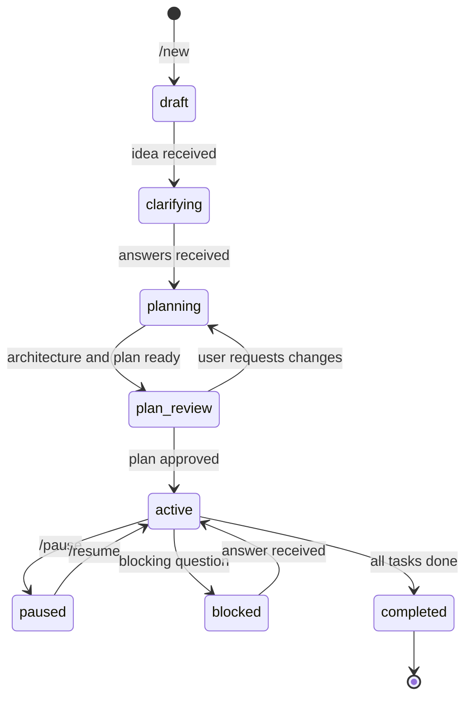
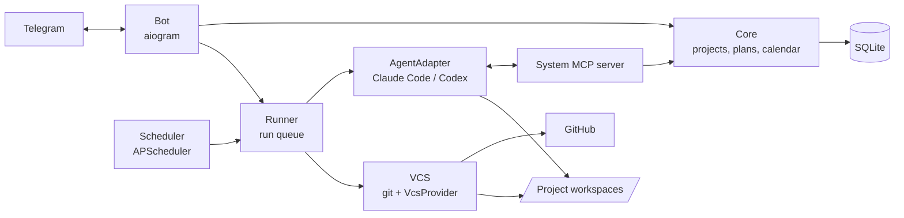

# Dayforge

**English** | [Русский](README.ru.md)

> Status: **MVP implemented**, covered by automated tests with fake agent CLIs and a fake Telegram API; checks against real Claude Code / Codex, Telegram and GitHub are still ahead.
> The detailed specification is in [docs/](docs/README.md) (in Russian).

A self-hosted system where **AI agents (Claude Code, Codex) build software projects from the user's idea**. The work doesn't happen in one go: it follows a **daily plan** the user has approved. Everything is controlled through a Telegram bot.

The user describes an idea. The agent asks clarifying questions and proposes an architecture and a day-by-day plan. The user approves it. From then on, on every working day the system carries out that day's tasks, commits the work, runs the tests and sends a report.

---

## Contents

- [Key features](#key-features)
- [Core concepts](#core-concepts)
- [Project lifecycle](#project-lifecycle)
- [Calendar and scheduling](#calendar-and-scheduling)
- [Daily run](#daily-run)
- [Git workflow](#git-workflow)
- [Agents](#agents)
- [Telegram bot](#telegram-bot)
- [System architecture](#system-architecture)
- [Generated project layout](#generated-project-layout)
- [MVP scope](#mvp-scope)
- [Development](#development)
- [Defaults](#defaults)

---

## Key features

- **Several projects at once.** Each one is its own git repository on the server, mirrored to GitHub.
- **Day-by-day plan.** The number of working days is set at creation. The agent spreads tasks across days, without fixed dates.
- **Shared calendar.** The user marks which projects are worked on which days, as many days ahead as they like. Leftover days are struck out automatically once a project is finished.
- **Early start.** A button starts the next plan day for one or several projects right away, without waiting for its calendar date.
- **Approval instead of micromanagement.** The user approves the plan and architecture, and the agent works on its own from there.
- **The plan can be changed at any time**, with a command or in a free-form conversation with the system agent.
- **Agent choice per project:** Claude Code or Codex, a specific model and a reasoning level.
- **Daily reports** in Telegram: what got done, commits, test results, unfinished tasks, questions.
- **Runs on subscriptions** (Claude Max / ChatGPT Pro) instead of pay-per-token API billing.

## Core concepts

| Concept | Meaning |
|---|---|
| **Project** | An idea plus a repository, a plan and settings (agent, model, priority, number of days). |
| **Plan** | A versioned list of *project days* (Day 1, Day 2, …), each holding tasks. The plan contains no calendar dates. |
| **Project day** | A logical unit of the plan, mapped to a real date through the calendar. |
| **Task** | One atomic feature or change: description, acceptance criteria, status, branch, commits. |
| **Slot** | A calendar date marked for a project. The next plan day runs in the nearest slot. |
| **Run** | Execution of one plan day's tasks for one project: scheduled, manual or early. |
| **System agent** | An agent with access to the system itself (projects, plans, calendar), used for free-form chat in Telegram. |

## Project lifecycle



1. **Creation (`/new`).** The user sends the idea in free form and can name a preferred stack. They also set the number of working days, the priority, and the agent, model and reasoning level.
2. **Clarification.** The planner agent asks one short round of clarifying questions.
3. **Architecture and plan.** The agent picks a stack if none was given and writes `ARCHITECTURE.md` and submits the plan with `submit_plan`, spreading tasks across days. The agent estimates the effort itself. If the work doesn't fit into the given number of days, it says so and suggests a different number.
4. **Approval.** The plan arrives in Telegram as a file with a short summary. The user approves it or sends changes in free text ("merge days 3 and 4", "use FastAPI"). The agent revises the plan and the loop repeats.
5. **Initialization.** The local repository is created right at `/new`, and the planner writes its documents there. Once the plan is approved, the system makes the first commit, creates the `dev` branch and a private GitHub repository, and pushes. It shows a forecast end date based on the calendar. If fewer days are marked in the calendar than the plan has, it warns and offers an "Add more days" button.
6. **Development.** Daily runs follow the calendar (see below).
7. **Completion.** All tasks are done, the final version is in `main`, and the system sends a final report.

## Calendar and scheduling

There is one **shared** calendar for all projects. The user sets:

- **Individual dates**: mark a project for specific days, as many as you like.
- **A weekly template** listing which projects run on which weekdays (repeats until the project is finished):
  ```
  Mon: A, B    Tue: A    Wed: B    Thu: A, B    Fri: —    Sat: —    Sun: —
  ```
- **Exceptions on specific dates**, such as a day off, a project swap or an extra day.
- **The daily run time**, one for the whole system (for example 03:00).
- **Project priority**, which sets the execution order within a day.

How it works:

- Plan days are **not tied to dates**: the project's nearest slot runs the next unfinished plan day. The first slot after approval runs Day 1, the next one Day 2, and so on.
- You can mark **as many slots as you like**, more than the plan has days. When the project is finished, all of its future slots are **struck out** (freed) automatically.
- **Early start:** a "Start next day" button for one or several projects. The plan day runs immediately, the remaining days move to earlier slots, and the project finishes sooner.
- The system can always compute a **forecast end date** (the date of the slot the last plan day will land on) and shows it in status and reports.
- If the slots run out while plan days remain, the user gets a notification with an **"Add more days"** button for the calendar.

## Daily run

At the configured time the scheduler collects every project that has a slot today, sorts them by priority and **runs them sequentially**, one project after another.

For each project:

1. The task queue is built: **unfinished tasks from the previous run first** (unless the user already finished them manually), then the tasks for the current plan day.
2. Each task runs in its own agent session. The agent implements the task, writes tests, runs them itself, commits to the task branch and calls `complete_task`. The system then checks the result and merges it into `dev` (see [Git workflow](#git-workflow)).
3. **Questions the agent can settle on its own, it settles.** The decision is written to `JOURNAL.md` and passed to `complete_task`, from where it goes into the report. The user gets no separate messages about them.
4. **A blocking question** is one that needs access, a key or a user decision. The agent asks it with `ask_user`, saves its progress (a WIP commit on the task branch plus a journal entry) and ends the session. The project is **paused** (`blocked`), and the queue moves on to the next project.
5. The user answers in Telegram and can press **"Continue now"**. The agent picks up **the same session** with the answer, then finishes the rest of the day's tasks. If another project is running at that moment, the continuation waits in the queue.
6. If the user doesn't continue manually, the project's **next slot** first finishes the unfinished tasks, then runs the new day's tasks. If there is still no answer by the next slot, the project skips that slot, the user gets a reminder and the forecast end date is recalculated.
7. At the end, a **report** is sent to Telegram.

Runs can also be started manually outside the schedule. `/run` finishes unfinished work, and `/next` starts the next plan day early for the chosen projects. They go through the same queue, one after another.

> Unfinished tasks should be rare, since the agent plans days with some slack. The mechanism exists so that nothing gets lost.

**Subscription limits.** If a usage limit is hit, the current task is paused the same way as for a blocking question, and the user is notified. It can be continued manually once the limit resets, otherwise it continues in the next slot.

**Run duration is not capped.** A run keeps going as long as the day's projects have active tasks (not blocked by a question) and the subscription limit isn't exhausted. A watchdog protects against hangs: if an agent session produces no events for a long time, it is stopped, the task is paused as unfinished and the user is notified.

## Git workflow

```
main  ●───────────────────────────●  (stable versions, tags v0.1, v0.2…)
       \                         /
dev     ●──●─────●──────●───────●
            \   / \    /
feature/…    ●─●   ●──●            (one task = one branch)
```

The work is split between the agent and the system:

- **The system creates the branch** before the session starts: `feature/<task-id>-<slug>`, from `dev`. One task, one branch.
- **The agent owns everything inside its branch:** commits, test runs, fixes.
- **The system is the final gate.** After `complete_task` it runs the tests with the command from the plan (`test_command`), merges the branch into `dev`, pushes and records the commits in the DB.
  - If the tests fail, the result goes back into the same agent session for one fix attempt. If that doesn't help, the task stays unfinished and runs first in the next run.
  - A merge conflict (almost impossible with sequential work) is handed to the agent to resolve.
- **Why the agent doesn't merge:** this is the one place where a mistake damages the shared branch. The agent might merge with failing tests ("that's unrelated to my task"), push to `main` or rewrite history. Deterministic code won't do that, and it costs about 50 lines and no tokens.
- `dev` is merged into `main` and tagged with a version when a **milestone** marked in the plan is completed. This can also be done manually.
- Every agent commit is recorded in the DB (sha, task, time). This is used for reports. Later it will let the system cheaply detect manual changes by the user without reading full diffs.
- Hosting is accessed through a `VcsProvider` interface. GitHub is the first implementation, and GitLab, Gitea and others can be added later.

## Agents

### How they run

Agents run as **headless CLIs** through subprocess, so they use the **subscription** the CLI is logged into on the server:

- **Claude Code**: `claude -p` with streaming JSON output (which exposes progress, usage and the final result), a chosen model and reasoning level, and no interactive confirmations.
- **Codex**: `codex exec` with a chosen model and `model_reasoning_effort`.

Both sit behind a common `AgentAdapter` interface: start a session with a prompt and a working directory, then receive an event stream and a final result. Supporting a new agent means writing a new adapter.

### Roles

| Role | Job | Works in |
|---|---|---|
| **Planner** | Clarifying questions, architecture, plan, replanning | The project repository (documents) |
| **Executor** | Implements one task, including tests | The task branch in the project repository |
| **System agent** | Free-form chat with the user (`/agent`): works out the request and carries it out through system tools | The directory with all projects (read-only), plus the system tools |

The agent, model and reasoning level can be chosen per project, separately for planning and for execution.

### Context

Every task is a **fresh session**, so the context doesn't grow without limit. The agent reads the repository itself: `IDEA.md`, `ARCHITECTURE.md`, `PLAN.md`, `JOURNAL.md`, `AGENTS.md`/`CLAUDE.md` and the code. Anything that isn't in the repository (the task itself, an answer to a question, requested plan changes) is passed in the session's opening prompt. Continuing after a blocking question resumes the same session.

### Tools (MCP)

Agents talk to the system through its own **MCP server**. Each role has its own set of tools.

**Executor**

| Tool | What it does |
|---|---|
| `ask_user(questions[])` | Blocking questions in Telegram. A question can list answer options, which become buttons. The task is paused |
| `request_secret(name, description)` | If the secret already exists, says it is in `.env` under that name. Otherwise, asks the user and pauses |
| `complete_task(summary, decisions[])` | "Task done". The system then runs the tests and merges; `summary` and `decisions` go into the report |
| `fail_task(reason)` | The task can't be done for a reason other than a question (for example, a mistake in the plan). The user is notified |
| `propose_plan_change(reason, proposal)` | Suggest a plan change (for example, splitting a task). Sent to the user and doesn't block work |

**Planner**

| Tool | What it does |
|---|---|
| `ask_user(questions[])` | Including the round of clarifying questions when a project is created |
| `submit_plan(days[], milestones[], test_command, summary)` | Submit the plan. The system validates the structure (errors go back to the agent), stores it in the DB and sends it to the user for approval: the whole new plan, or a diff when replanning. The user's changes come back into the same session |

The planner writes `ARCHITECTURE.md` directly in the repository in free form. Only the plan needs a fixed structure.

**System agent**: reading

| Tool | What it does |
|---|---|
| `list_projects()` | All projects: status, current day, forecast end date |
| `get_project(project)` | Details: settings, plan, journal, recent commits |
| `get_calendar(from, to)` | The calendar for a period |
| `get_runs(project?, limit)`, `get_run_log(run_id)` | Run history and logs, to find out why something failed |
| `get_pending_questions()` | Agent questions the user hasn't answered yet |

**System agent**: changes

| Tool | What it does | Confirmation |
|---|---|:-:|
| `create_project(idea, days, priority, agent_settings, stack?)` | Starts the same flow as `/new` | |
| `request_replan(project, instructions)` | Hands the job to the planner; the result goes to the user | ✓ (plan diff) |
| `add_task(project, description, when: now\|next)` | A one-off task outside the plan ("fix the typo in the README"). A regular executor does it through the regular git workflow | |
| `update_calendar(changes[])` | Add or remove days, change the weekly template, exceptions | for bulk changes |
| `set_priority(order[])` | Project order | |
| `update_project_settings(project, settings)` | Agent, model, reasoning, number of days | |
| `pause_project`, `resume_project` | Pause and resume | |
| `answer_question(question_id, answer)` | Answer an agent's question through the chat ("tell project A to use Postgres") | |
| `start_run(projects[], mode: continue\|next)` | Same as `/run` and `/next` | |
| `release` | Manual release from `dev` to `main` | ✓ |
| `archive_project`, `delete_project` | Archive or delete a project | ✓ |

### Rules

- **The executor and planner are limited to their own project.** The MCP server is given the project and role when the session starts, so they don't need a `project` parameter. Other projects and system tools are not available to them.
- **`ask_user` is always blocking.** It records the question, sends it to Telegram and tells the agent to save its progress and end the session. The answer is passed back into that same session when it continues.
- **Plans go only through `submit_plan`**, never through edits to `PLAN.md`; the system generates that file.
- **The system agent is a "manager" with broad access**, but it changes system state **only through tools**, never directly in the DB or files. This keeps linked data consistent (plan and `PLAN.md`, calendar and forecast). It only reads project code. Any code change goes through `add_task`, so all changes follow one path: branch, tests, merge, journal, report.
- Plan changes and actions that are hard to undo create a "pending action", and the bot sends a diff or description with a confirmation button.
- `/agent` is a conversation: messages continue one agent session. It resets with a command or after a long pause.
- The tools are a thin wrapper over the core layer that the bot also uses. A CLI for administration over SSH can easily be added on top of it.

### What the system does, not the agents

- creating branches, the final test run, merging, pushing, tagging, recording commits in the DB;
- generating `PLAN.md` from the DB;
- sending Telegram messages;
- building reports: the agent writes the **text** (`summary`, `decisions`), and the system fills in the **facts** (commits, test results, what's unfinished, forecast), which it knows exactly and at no cost.

### Access and secrets

The agent has full permissions inside the project's working directory and runs under a dedicated unix user. If something is missing (an API key, a token, access to a service), the agent calls `request_secret`. The user gets the request in Telegram, and the value is stored in the project's `.env`, which is git-ignored.

## Telegram bot

The bot responds **only to its owner**, identified by Telegram user id.

| Command | Action |
|---|---|
| `/new` | Create a project (dialog: idea, stack, number of days, priority, agent) |
| `/projects` | List projects with status and forecast end dates |
| `/status <project>` | Detailed status: current day, tasks, recent commits |
| `/plan <project>` | Current plan (as a file plus a short summary) |
| `/replan <project> <change>` | Ask the agent to change the plan; the plan diff comes back for approval |
| `/calendar` | View and edit the calendar, exceptions and run time |
| `/priority` | Change project order |
| `/pause`, `/resume <project>` | Pause or resume a project |
| `/run [project]` | Finish unfinished work now, outside the schedule |
| `/next` | Start the next plan day early; pick one or several projects with buttons |
| `/release <project>` | Manual release from `dev` to `main`, with a tag |
| `/report [project]` | Latest report |
| `/agent <request>` | Free-form chat with the system agent ("push project B until after the holidays and add Google sign-in to A"). Plain text outside other dialogs also goes to the system agent |
| `/agent_reset` | Start a new conversation with the system agent |
| `/settings` | Global settings: default agents, run time |

**Notifications:** daily report, unfinished tasks, blocking question (with a "Continue now" button once answered), the agent's suggestion to change the plan, a task that can't be done (`fail_task`), secret request, not enough days in the calendar (with an "Add more days" button), subscription limit hit, run error, project completed.

**The daily report** is built by the system. It contains the completed tasks with the agent's description, decisions the agent made on its own, branches and commits (as GitHub links), test results, what was left unfinished and why, and the forecast end date.

## System architecture



**Stack:** Python 3.12+, [uv](https://github.com/astral-sh/uv), aiogram 3, APScheduler, SQLAlchemy 2 + Alembic, SQLite (PostgreSQL possible later), pydantic-settings, the official MCP Python SDK. Runs as a systemd service on a VPS.

**Repository layout:**

```
dayforge/                 # repository
├── dayforge/             # Python package
│   ├── app.py            # process wiring: bot, runner, scheduler, MCP
│   ├── services.py       # core services container
│   ├── orchestrator.py   # planner, plan approval, replanning, releases
│   ├── chat.py           # system-agent conversation (/agent)
│   ├── actions.py        # actions run after user confirmation
│   ├── config.py         # configuration from .env
│   ├── bot/              # Telegram handlers, keyboards, dialogs
│   ├── core/             # domain logic: projects, plans, calendar, tasks, settings
│   ├── scheduler/        # daily runs, backups, reminders
│   ├── runner/           # run execution: task queue, pause/resume, gate, reports
│   ├── agents/           # AgentAdapter + claude_code.py, codex.py
│   ├── vcs/              # git operations + providers (github.py)
│   ├── mcp_server/       # MCP server with tools for agents
│   ├── backup/           # restic backups
│   └── db/               # models and migrations
├── prompts/              # prompt templates for agent roles
├── deploy/               # systemd unit, agent launch wrapper, sudoers
├── scripts/              # restore.sh — restore from backup
├── docs/                 # detailed specification
├── tests/
├── AGENTS.md             # rules for agents (CLAUDE.md points to it)
├── Makefile              # make help — development and server commands
├── alembic.ini
├── .env.example
└── pyproject.toml
```

**Storage:** system state lives in the DB. Project working copies live in `/srv/dayforge/projects/<slug>/` (configurable). The plan is stored in the DB. `PLAN.md` in the repository is generated from it and updated in `dev` after every merge. Why not just the file: in git the file has several copies (in `dev` and in the task branch), so completion marks would conflict on merge. Also, the scheduler and the bot constantly need a reliable answer to "which day is next and what's not done", and parsing markdown written by an agent is fragile.

## Generated project layout

```
<project>/
├── docs/
│   ├── IDEA.md           # original idea and answers to clarifying questions
│   ├── ARCHITECTURE.md   # stack, modules, decisions
│   ├── PLAN.md           # day-by-day plan, task statuses, milestones (generated by the system)
│   └── JOURNAL.md        # agent log: work done, decisions made
├── AGENTS.md             # agent instructions (CLAUDE.md points to it)
├── .env                  # secrets (git-ignored)
└── …project code
```

## MVP scope

**In scope:**

- A single user and a Telegram bot with all the commands above.
- Project creation: idea, clarification, architecture and plan, approval.
- Shared calendar: weekly template, individual dates, exceptions, priorities, forecast end date, striking out leftover days after completion.
- Sequential daily runs, plus manual `/run` and early `/next` for several projects.
- Unfinished tasks run first in the next run, blocking questions pause the project and resume the session, secret requests.
- Git workflow: a branch per task, merged into `dev`, then into `main` per milestone. Pushed to GitHub, with agent commits tracked in the DB.
- Claude Code and Codex adapters with model and reasoning selection.
- `/replan` and `/agent` (the system agent via MCP).
- Daily reports and notifications.

**Out of scope, with hooks left in place:**

- Detecting the user's manual changes in a repository and adjusting the plan automatically. The MVP assumes only the agent touches the repository. Tracking agent commits in the DB is groundwork for this.
- Other git hosts (GitLab, Gitea), via `VcsProvider`.
- Deploying projects. This will be a separate system in the future.
- Parallel runs, Docker isolation, multiple users.

## Development

Agents and developers should start with [AGENTS.md](AGENTS.md) and [docs/development.md](docs/development.md) (in Russian). Commands: `make help`.

```bash
uv sync
cp .env.example .env          # BASE_DIR=./var, a test bot token, your Telegram id
uv run alembic upgrade head
uv run python -m dayforge     # bot, scheduler and MCP server
uv run pytest
uv run ruff check . && uv run ruff format .
```

After changing the models, create a migration: `uv run alembic revision --autogenerate -m "<description>"`. The `test_migrations_match_models` test fails if you forget.

Server installation is described in [docs/operations.md](docs/operations.md).

## Defaults

Open to revision:

- If a day's tasks finish early, the next day is **not** started automatically, which keeps subscription usage predictable. It can be started manually with `/next`.
- `dev` is merged into `main` at milestones that the agent sets in the plan.
- The system runs the tests again before merging. If they fail, the agent gets one fix attempt in the same session, then the task stays unfinished.
- There is one run time for the whole system.
- Backups:
  - **Code** lives on GitHub. The system pushes not only `dev` and `main` but also task branches with WIP commits, so unfinished work isn't lost either.
  - **Everything not on GitHub** (the DB, snapshotted with `sqlite3 .backup`, which is safe on a live database; every project's `.env`; the system config) is encrypted once a day after the run window and sent to external S3-compatible storage (Backblaze B2, Cloudflare R2 and similar) with [restic](https://restic.net/). It keeps 7 daily, 4 weekly and 6 monthly copies.
  - A failed backup triggers a Telegram notification. The restore procedure is documented in `docs/`.
  - Agent sessions are not backed up. If a session is lost, continuation starts a new session from the WIP commit and the journal entry.
