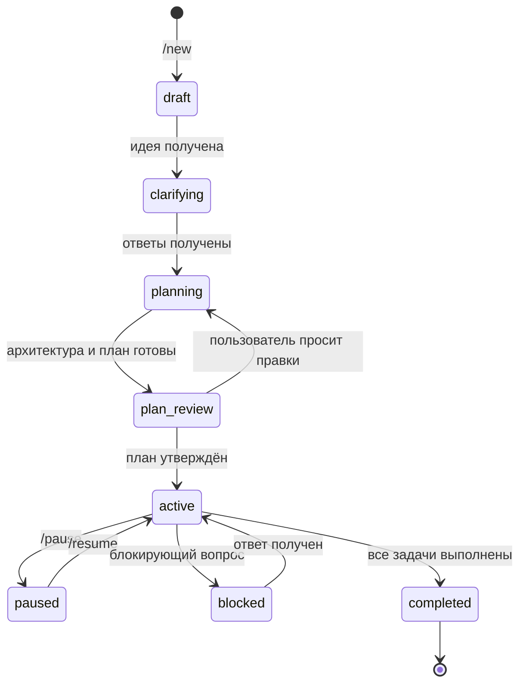
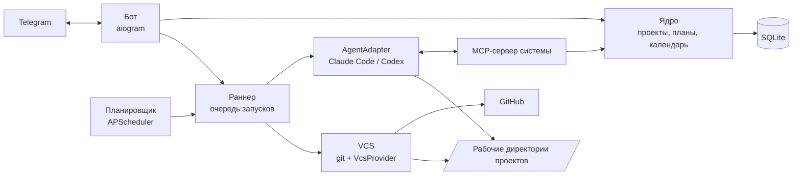

# Dayforge

[English](README.md) | **Русский**

> Статус: **ранняя разработка** — есть каркас (конфиг, БД, бот, MCP-сервер), функции в работе.
> Подробная спецификация — в [docs/](docs/README.md).

Система на собственном сервере, которая по идее пользователя **сама разрабатывает программные проекты силами AI-агентов** (Claude Code, Codex) — не за один присест, а **по ежедневному плану**, согласованному с пользователем. Управление — через Telegram-бота.

Пользователь описывает идею → агент задаёт уточняющие вопросы и предлагает архитектуру и план по дням → пользователь согласовывает → дальше система каждый рабочий день сама выполняет задачи дня, коммитит, прогоняет тесты и присылает отчёт.

---

## Содержание

- [Ключевые возможности](#ключевые-возможности)
- [Основные понятия](#основные-понятия)
- [Жизненный цикл проекта](#жизненный-цикл-проекта)
- [Календарь и расписание](#календарь-и-расписание)
- [Ежедневный запуск](#ежедневный-запуск)
- [Git-процесс](#git-процесс)
- [Агенты](#агенты)
- [Telegram-бот](#telegram-бот)
- [Архитектура системы](#архитектура-системы)
- [Структура создаваемого проекта](#структура-создаваемого-проекта)
- [Объём MVP](#объём-mvp)
- [Разработка](#разработка)
- [Решения по умолчанию](#решения-по-умолчанию)

---

## Ключевые возможности

- **Несколько проектов одновременно.** Каждый — отдельный git-репозиторий на сервере, зеркалируемый на GitHub.
- **План по дням.** При создании задаётся число рабочих дней; агент раскладывает задачи по дням (без привязки к датам).
- **Общий календарь.** Пользователь отмечает, в какие дни какими проектами заниматься, — сколько угодно дней наперёд. Лишние дни после завершения проекта автоматически вычёркиваются.
- **Досрочный запуск.** Кнопкой можно начать следующий день плана для одного или нескольких проектов, не дожидаясь даты по календарю.
- **Согласование, а не микроменеджмент.** Пользователь утверждает план и архитектуру, дальше агент работает сам.
- **Изменение плана в любой момент** — командой или в свободном диалоге с системным агентом.
- **Выбор агента на проект:** Claude Code или Codex, конкретная модель и уровень reasoning.
- **Ежедневные отчёты** в Telegram: что сделано, коммиты, тесты, что не доделано, вопросы.
- **Работа по подписке** (Claude Max / ChatGPT Pro), без оплаты API за токены.

## Основные понятия

| Понятие | Что это |
|---|---|
| **Проект** | Идея + репозиторий + план + настройки (агент, модель, приоритет, число дней). |
| **План** | Версионируемый список *дней проекта* (День 1, День 2, …), в каждом — задачи. Конкретных дат в плане нет. |
| **День проекта** | Логическая единица плана. Отображается на реальную дату через календарь. |
| **Задача** | Атомарная фича/изменение: описание, критерии готовности, статус, ветка, коммиты. |
| **Слот** | Дата в календаре, отмеченная для проекта. Следующий день плана выполняется в ближайший слот. |
| **Запуск (run)** | Выполнение задач одного дня плана для одного проекта — по расписанию, вручную или досрочно. |
| **Системный агент** | Агент с доступом к самой системе (проекты, планы, календарь) для свободного диалога в Telegram. |

## Жизненный цикл проекта



1. **Создание (`/new`).** Пользователь присылает идею в свободной форме; опционально — желаемый стек. Задаются: число рабочих дней, приоритет, агент/модель/reasoning.
2. **Уточнение.** Агент-планировщик задаёт один короткий раунд уточняющих вопросов.
3. **Архитектура и план.** Агент выбирает стек (если не задан), пишет `ARCHITECTURE.md` и отправляет план через `submit_plan`, раскладывая задачи по дням. Агент сам оценивает трудоёмкость; если в заданное число дней не укладывается — говорит об этом и предлагает другое число.
4. **Согласование.** План приходит в Telegram файлом + краткое резюме. Пользователь утверждает или пишет правки свободным текстом («объедини дни 3 и 4», «используй FastAPI») — агент переделывает план, цикл повторяется.
5. **Инициализация.** Локальный репозиторий создаётся сразу при `/new` (в нём планировщик пишет документы). После утверждения система делает первый коммит, создаёт ветку `dev` и приватный репозиторий на GitHub, пушит. Показывается прогноз даты окончания по календарю; если отмеченных в календаре дней меньше, чем дней в плане, — предупреждение с кнопкой «Назначить ещё дни».
6. **Разработка.** Ежедневные запуски по календарю (см. ниже).
7. **Завершение.** Все задачи выполнены, финальная версия в `main`, итоговый отчёт.

## Календарь и расписание

Календарь **общий** для всех проектов. Пользователь задаёт:

- **Отдельные даты** — отметить проект на конкретные дни (сколько угодно).
- **Недельный шаблон** — какие проекты в какие дни недели (повторяется, пока проект не завершён):
  ```
  Пн: A, B    Вт: A    Ср: B    Чт: A, B    Пт: —    Сб: —    Вс: —
  ```
- **Исключения на конкретные даты** — выходной, замена проектов, дополнительный день.
- **Время ежедневного запуска** (одно на всю систему, например 03:00).
- **Приоритет проектов** — порядок выполнения внутри одного дня.

Как это работает:

- Дни плана **не привязаны к датам**: в ближайший слот проекта выполняется следующий невыполненный день плана. Первый слот после утверждения → День 1, следующий → День 2 и т.д.
- Слотов можно отметить **сколько угодно** — больше, чем дней в плане. Когда проект завершён, все его будущие слоты **вычёркиваются** (освобождаются) автоматически.
- **Досрочный запуск:** кнопка «Начать следующий день» для одного или нескольких проектов. День плана выполняется сразу, остальные дни сдвигаются на более ранние слоты, и проект заканчивается раньше.
- Система всегда может посчитать **прогнозную дату окончания** (дата слота, на который придётся последний день плана) и показывает её в статусе и отчётах.
- Если слоты закончились, а дни плана остались — уведомление с кнопкой **«Назначить ещё дни»** в календаре.

## Ежедневный запуск

В заданное время планировщик собирает проекты, у которых сегодня слот, сортирует по приоритету и **выполняет их последовательно** (один проект за другим).

Для каждого проекта:

1. Формируется очередь задач: **сначала незавершённые** с прошлого запуска (если пользователь не доделал их вручную), затем задачи текущего дня плана.
2. Каждая задача выполняется в отдельной сессии агента. Агент реализует задачу, пишет тесты, сам их гоняет, коммитит в ветку задачи и вызывает `complete_task`. После этого система проверяет результат и мержит его в `dev` (см. [Git-процесс](#git-процесс)).
3. **Вопросы, которые агент может решить сам, он решает сам.** Решение записывается в `JOURNAL.md` и передаётся в `complete_task`, откуда попадает в отчёт. Отдельных сообщений пользователю нет.
4. **Блокирующий вопрос** (нужен доступ, ключ, решение пользователя) — агент задаёт его через `ask_user`, сохраняет прогресс (WIP-коммит в ветке задачи + запись в журнале) и завершает сессию. Проект **ставится на паузу** (`blocked`), очередь переходит к следующему проекту.
5. Пользователь отвечает в Telegram и может нажать **«Продолжить сейчас»**: агент продолжает **ту же сессию** с ответом, затем доделывает оставшиеся задачи дня. Если в этот момент работает другой проект — продолжение встаёт в очередь.
6. Если пользователь не продолжил вручную, в **следующем слоте** проекта сначала доделываются незавершённые задачи, затем задачи нового дня. Если к следующему слоту ответа так и нет — проект пропускает слот, пользователь получает напоминание, прогноз окончания пересчитывается.
7. В конце — **отчёт** в Telegram.

Вне расписания можно запустить вручную: `/run` доделывает незавершённое, а `/next` досрочно начинает следующий день плана для выбранных проектов. Они выполняются по той же очереди, последовательно.

> Незавершённые задачи должны быть редкостью: агент планирует дни с запасом. Но механизм нужен, чтобы ничего не потерялось.

**Лимиты подписки.** Если упёрлись в лимит использования — текущая задача приостанавливается так же, как при блокирующем вопросе, пользователь получает уведомление. Продолжить можно вручную после сброса лимита, иначе — в следующем слоте.

**Длительность запуска не ограничена.** Запуск работает, пока у проектов дня есть активные задачи (не заблокированные вопросом) и не исчерпан лимит подписки. От зависания защищает watchdog: если сессия агента долго не выдаёт событий, она прерывается, задача ставится на паузу как незавершённая, пользователь получает уведомление.

## Git-процесс

```
main  ●───────────────────────────●  (стабильные версии, теги v0.1, v0.2…)
       \                         /
dev     ●──●─────●──────●───────●
            \   / \    /
feature/…    ●─●   ●──●            (одна задача = одна ветка)
```

Работа делится между агентом и системой:

- **Ветку создаёт система** перед запуском сессии: `feature/<task-id>-<slug>` от `dev`. Одна задача — одна ветка.
- **Агент отвечает за всё внутри своей ветки:** коммиты, прогон тестов, исправления.
- **Система — финальный шлюз.** После `complete_task` она прогоняет тесты командой из плана (`test_command`), мержит ветку в `dev`, пушит и записывает коммиты в БД.
  - Тесты красные → результат возвращается в ту же сессию агента на одну попытку исправления. Не помогло — задача остаётся незавершённой и выполняется первой в следующем запуске.
  - Конфликт при мерже (при последовательной работе почти невозможен) → его разрешение отдаётся агенту.
- **Почему мерж не у агента:** это единственное место, где ошибка портит общую ветку — мерж с красными тестами («это не связано с моей задачей»), пуш в `main`, переписанная история. Детерминированный код так не ошибётся, а стоит он ~50 строк и ни одного токена.
- `dev` → `main`: при завершении **вехи (milestone)**, отмеченной в плане, + тег версии. Также возможно вручную.
- Все коммиты агента записываются в БД (sha, задача, время). Это нужно для отчётов, а в будущем — для дешёвого обнаружения ручных изменений пользователя без чтения полного diff.
- Работа с хостингом скрыта за интерфейсом `VcsProvider`; первая реализация — GitHub, позже можно добавить GitLab, Gitea и т.д.

## Агенты

### Как запускаются

Агенты запускаются как **CLI в headless-режиме** через subprocess — так они используют **подписку**, на которую залогинен CLI на сервере:

- **Claude Code** — `claude -p` с потоковым JSON-выводом (по нему видно прогресс, расход и итог), выбор модели и уровня reasoning, без интерактивных подтверждений.
- **Codex** — `codex exec` с выбором модели и `model_reasoning_effort`.

Оба скрыты за единым интерфейсом `AgentAdapter` (запустить сессию с промптом и рабочей директорией → получить поток событий и итоговый результат). Добавление нового агента = новый адаптер.

### Роли

| Роль | Задача | Где работает |
|---|---|---|
| **Планировщик** | Уточняющие вопросы, архитектура, план, перепланирование | Репозиторий проекта (документы) |
| **Исполнитель** | Реализация одной задачи + тесты | Ветка задачи в репозитории проекта |
| **Системный агент** | Свободный диалог с пользователем (`/agent`): понять запрос и выполнить его через инструменты системы | Директория со всеми проектами (только чтение) + инструменты системы |

Для каждого проекта можно выбрать агента, модель и уровень reasoning — отдельно для планирования и для исполнения.

### Контекст

Каждая задача — **новая сессия**: контекст не раздувается. Агент сам читает репозиторий — `IDEA.md`, `ARCHITECTURE.md`, `PLAN.md`, `JOURNAL.md`, `AGENTS.md`/`CLAUDE.md` и код. То, чего в репозитории нет (сама задача, ответ на вопрос, правки к плану), система передаёт в стартовом промпте. Продолжение после блокирующего вопроса идёт в той же сессии.

### Инструменты (MCP)

Агенты общаются с системой через собственный **MCP-сервер**. У каждой роли — свой набор инструментов.

**Исполнитель**

| Инструмент | Что делает |
|---|---|
| `ask_user(questions[])` | Блокирующие вопросы в Telegram; у вопроса можно указать варианты ответа — они станут кнопками. Задача ставится на паузу |
| `request_secret(name, description)` | Если секрет уже есть — сообщает, что он в `.env` под этим именем. Если нет — запрос пользователю и пауза |
| `complete_task(summary, decisions[])` | «Задача готова». Дальше система прогоняет тесты и мержит; `summary` и `decisions` идут в отчёт |
| `fail_task(reason)` | Задачу нельзя выполнить не из-за вопроса (например, ошибка в плане). Пользователь получает уведомление |
| `propose_plan_change(reason, proposal)` | Предложить изменение плана (например, разбить задачу). Уходит пользователю, работу не блокирует |

**Планировщик**

| Инструмент | Что делает |
|---|---|
| `ask_user(questions[])` | В том числе раунд уточняющих вопросов при создании проекта |
| `submit_plan(days[], milestones[], test_command, summary)` | Отправить план. Система проверяет структуру (ошибки возвращаются агенту), сохраняет в БД и присылает пользователю на согласование — новый план целиком или diff при перепланировании. Правки пользователя возвращаются в ту же сессию |

`ARCHITECTURE.md` планировщик пишет прямо в репозиторий в свободной форме — структурированным должен быть только план.

**Системный агент** — чтение:

| Инструмент | Что делает |
|---|---|
| `list_projects()` | Все проекты: статус, текущий день, прогноз окончания |
| `get_project(project)` | Подробно: настройки, план, журнал, последние коммиты |
| `get_calendar(from, to)` | Календарь за период |
| `get_runs(project?, limit)`, `get_run_log(run_id)` | История запусков и их логи — разобраться, почему что-то упало |
| `get_pending_questions()` | Вопросы агентов, на которые пользователь ещё не ответил |

**Системный агент** — изменения:

| Инструмент | Что делает | Подтверждение |
|---|---|:-:|
| `create_project(idea, days, priority, agent_settings, stack?)` | Запускает тот же процесс, что `/new` | |
| `request_replan(project, instructions)` | Отдаёт задачу планировщику, результат приходит пользователю | ✓ (diff плана) |
| `add_task(project, description, when: now\|next)` | Разовая задача вне плана («поправь опечатку в README»). Выполняет обычный исполнитель по обычному git-процессу | |
| `update_calendar(changes[])` | Добавить/убрать дни, недельный шаблон, исключения | при массовых изменениях |
| `set_priority(order[])` | Порядок проектов | |
| `update_project_settings(project, settings)` | Агент, модель, reasoning, число дней | |
| `pause_project`, `resume_project` | Пауза и возобновление | |
| `answer_question(question_id, answer)` | Ответить на вопрос агента через диалог («скажи проекту A брать Postgres») | |
| `start_run(projects[], mode: continue\|next)` | То же, что `/run` и `/next` | |
| `release` | Ручной релиз `dev` → `main` | ✓ |
| `archive_project`, `delete_project` | Архивировать / удалить проект | ✓ |

### Правила

- **Исполнитель и планировщик ограничены своим проектом.** MCP-сервер получает проект и роль при запуске сессии; параметр `project` им не нужен, чужие проекты и системные инструменты недоступны.
- **`ask_user` всегда блокирующий.** Он регистрирует вопрос, отправляет его в Telegram и отвечает агенту: «сохрани прогресс и заверши сессию». Ответ возвращается в ту же сессию при продолжении.
- **План — только через `submit_plan`**, а не правкой `PLAN.md`: файл генерирует система.
- **Системный агент — «менеджер» с широким доступом**, но состояние системы он меняет **только через инструменты**, а не напрямую в БД или файлах — так не нарушаются связи (план ↔ `PLAN.md`, календарь ↔ прогноз). Код проектов он только читает; любые изменения кода — через `add_task`, чтобы они шли одним путём: ветка → тесты → мерж → журнал → отчёт.
- Изменения плана и действия, которые сложно откатить, создают «ожидающее действие» — бот присылает diff или описание с кнопкой подтверждения.
- `/agent` — это диалог: сообщения продолжают одну сессию агента; сброс — командой или после долгой паузы.
- Инструменты — тонкая обёртка над слоем ядра, тем же, что использует бот. При необходимости поверх него легко сделать CLI для администрирования по SSH.

### Что делает система, а не агенты

- создание веток, финальный прогон тестов, мерж, пуш, теги, запись коммитов в БД;
- генерация `PLAN.md` из БД;
- отправка сообщений в Telegram;
- сборка отчётов: **текст** (`summary`, `decisions`) пишет агент, **факты** (коммиты, результат тестов, что не доделано, прогноз) подставляет система — она знает их точно и бесплатно.

### Доступы и секреты

Агент работает с полными правами внутри рабочей директории проекта (под отдельным unix-пользователем). Если чего-то не хватает (API-ключ, токен, доступ к сервису), агент вызывает `request_secret` → пользователь получает запрос в Telegram → значение сохраняется в `.env` проекта (в `.gitignore`).

## Telegram-бот

Бот отвечает **только владельцу** (по Telegram user id).

| Команда | Действие |
|---|---|
| `/new` | Создать проект (диалог: идея, стек, число дней, приоритет, агент) |
| `/projects` | Список проектов со статусами и прогнозными датами |
| `/status <проект>` | Подробный статус: текущий день, задачи, последние коммиты |
| `/plan <проект>` | Текущий план (файлом + кратко) |
| `/replan <проект> <что изменить>` | Попросить агента изменить план → diff плана на утверждение |
| `/calendar` | Просмотр и редактирование календаря, исключений, времени запуска |
| `/priority` | Изменить порядок проектов |
| `/pause`, `/resume <проект>` | Приостановить / возобновить проект |
| `/run [проект]` | Доделать незавершённое сейчас, вне расписания |
| `/next` | Досрочно начать следующий день плана — выбор одного или нескольких проектов кнопками |
| `/release <проект>` | Ручной релиз `dev` → `main` с тегом |
| `/report [проект]` | Последний отчёт |
| `/agent <запрос>` | Свободный диалог с системным агентом («перенеси проект B на после праздников и добавь в A авторизацию через Google»). Обычный текст вне диалогов тоже уходит системному агенту |
| `/agent_reset` | Начать новый диалог с системным агентом |
| `/settings` | Глобальные настройки: агенты по умолчанию, время запуска |

**Уведомления:** ежедневный отчёт, незавершённые задачи, блокирующий вопрос (с кнопкой «Продолжить сейчас» после ответа), предложение агента изменить план, задача не может быть выполнена (`fail_task`), запрос секрета, в календаре не хватает дней (с кнопкой «Назначить ещё дни»), лимит подписки, ошибка запуска, завершение проекта.

**Ежедневный отчёт** собирает система: выполненные задачи с описанием от агента, решения, принятые агентом самостоятельно, ветки и коммиты (ссылками на GitHub), результат тестов, что не доделано и почему, прогноз окончания.

## Архитектура системы



**Стек:** Python 3.12+, [uv](https://github.com/astral-sh/uv), aiogram 3, APScheduler, SQLAlchemy 2 + Alembic, SQLite (с возможностью перейти на PostgreSQL), pydantic-settings, официальный Python SDK для MCP. Запуск как systemd-сервис на VPS.

**Структура репозитория:**

```
dayforge/                 # репозиторий
├── dayforge/             # Python-пакет
│   ├── app.py            # сборка процесса: бот, планировщик, MCP
│   ├── config.py         # конфигурация из .env
│   ├── bot/              # хендлеры Telegram, клавиатуры, диалоги
│   ├── core/             # доменная логика: проекты, планы, календарь, задачи, настройки
│   ├── scheduler/        # ежедневные запуски, бэкап, напоминания
│   ├── runner/           # выполнение запуска: очередь задач, пауза/продолжение, шлюз, отчёт
│   ├── agents/           # AgentAdapter + claude_code.py, codex.py
│   ├── vcs/              # git-операции + провайдеры (github.py)
│   ├── mcp_server/       # MCP-сервер с инструментами для агентов
│   ├── backup/           # бэкап в restic
│   └── db/               # модели и миграции
├── prompts/              # шаблоны промптов для ролей агентов
├── deploy/               # systemd-юнит, обёртка запуска агентов, sudoers
├── docs/                 # подробная спецификация
├── tests/
├── alembic.ini
├── .env.example
└── pyproject.toml
```

**Хранение:** состояние системы — в БД; рабочие копии проектов — в `/srv/dayforge/projects/<slug>/` (настраивается). План хранится в БД, а `PLAN.md` в репозитории генерируется из неё и обновляется в `dev` после каждого мержа. Почему не только файл: у файла в git несколько копий (в `dev` и в ветке задачи) — отметки о выполнении конфликтовали бы при мерже; к тому же планировщику и боту постоянно нужны надёжные ответы «какой следующий день, что не сделано», а разбирать markdown от агента хрупко.

## Структура создаваемого проекта

```
<project>/
├── docs/
│   ├── IDEA.md           # исходная идея и ответы на уточняющие вопросы
│   ├── ARCHITECTURE.md   # стек, модули, решения
│   ├── PLAN.md           # план по дням, статусы задач, вехи (генерируется системой)
│   └── JOURNAL.md        # журнал агента: что сделано, принятые решения
├── AGENTS.md             # инструкции для агента (+ CLAUDE.md → ссылка на него)
├── .env                  # секреты (в .gitignore)
└── …код проекта
```

## Объём MVP

**Входит:**

- Один пользователь, Telegram-бот со всеми командами выше.
- Создание проекта: идея → уточнение → архитектура и план → согласование.
- Общий календарь: недельный шаблон, отдельные даты, исключения, приоритеты, прогноз окончания, вычёркивание лишних дней после завершения.
- Ежедневные последовательные запуски + ручной `/run` + досрочный `/next` для нескольких проектов.
- Незавершённые задачи первыми в следующем запуске, блокирующие вопросы с паузой и продолжением сессии, запрос секретов.
- Git-процесс: ветка на задачу → `dev` → `main` по вехам, пуш на GitHub, учёт коммитов агента в БД.
- Адаптеры Claude Code и Codex с выбором модели и reasoning.
- `/replan` и `/agent` (системный агент через MCP).
- Ежедневные отчёты и уведомления.

**Не входит (заложена возможность):**

- Обнаружение ручных изменений пользователя в репозитории и автоматическая корректировка плана. В MVP считаем, что с репозиторием работает только агент; учёт коммитов агента в БД — задел под это.
- Другие git-хостинги (GitLab, Gitea) — через `VcsProvider`.
- Деплой проектов — отдельная система в будущем.
- Параллельные запуски, изоляция в Docker, несколько пользователей.

## Разработка

```bash
uv sync
cp .env.example .env          # BASE_DIR=./var, токен тестового бота, свой Telegram id
uv run alembic upgrade head
uv run python -m dayforge     # бот, планировщик и MCP-сервер
uv run pytest
uv run ruff check . && uv run ruff format .
```

После изменения моделей — новая миграция: `uv run alembic revision --autogenerate -m "<описание>"`. Тест `test_migrations_match_models` падает, если миграцию забыли.

Установка на сервер — [docs/operations.md](docs/operations.md).

## Решения по умолчанию

Можно пересмотреть:

- Если задачи дня закончились раньше, следующий день автоматически **не** начинается (расход подписки предсказуем) — только вручную через `/next`.
- `dev` → `main` — по вехам, которые агент расставляет в плане.
- Перед мержем система ещё раз прогоняет тесты; при падении — одна попытка починки в той же сессии, затем задача остаётся незавершённой.
- Время запуска — одно на всю систему.
- Бэкапы:
  - **Код** — на GitHub. Система пушит не только `dev` и `main`, но и ветки задач с WIP-коммитами, так что незаконченная работа тоже не теряется.
  - **Всё, чего нет на GitHub** — БД (снапшот через `sqlite3 .backup`, безопасно на работающей базе), `.env` всех проектов, конфиг системы — раз в сутки после окна запусков шифруется и уходит во внешнее S3-совместимое хранилище (Backblaze B2, Cloudflare R2 и т.п.) через [restic](https://restic.net/). Хранится 7 ежедневных, 4 еженедельных и 6 ежемесячных копий.
  - Ошибка бэкапа → уведомление в Telegram. Процедура восстановления описывается в `docs/`.
  - Сессии агентов не бэкапятся: если сессия потеряна, продолжение начинается с новой сессии по WIP-коммиту и записи в журнале.
