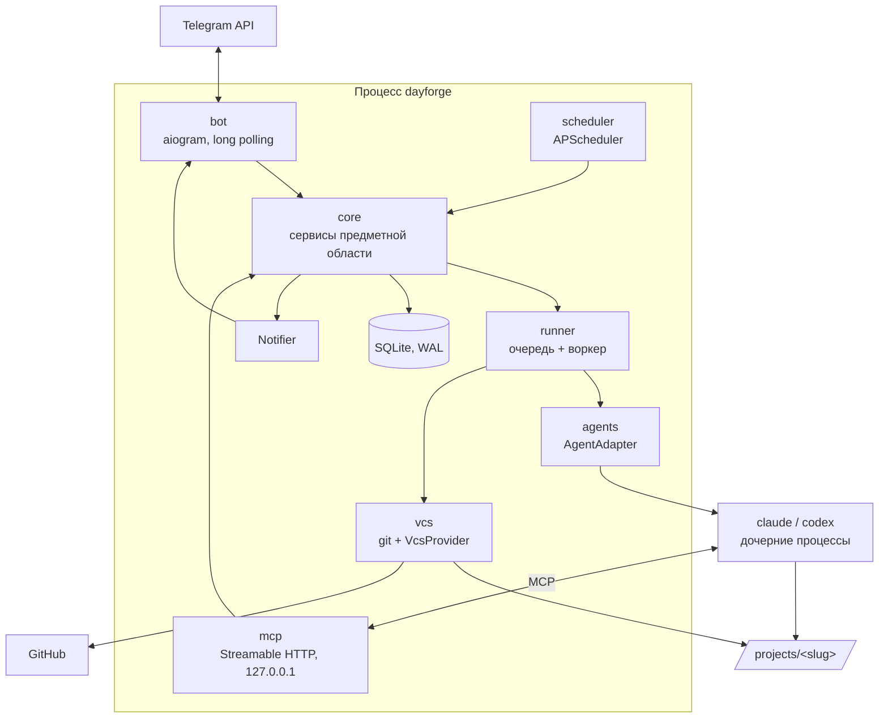
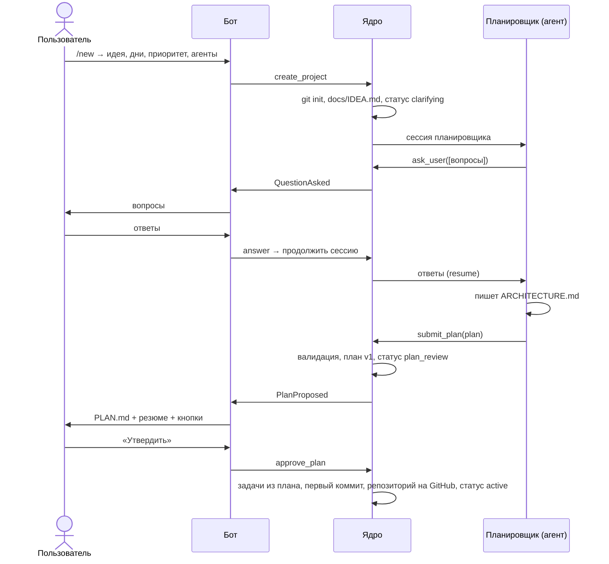
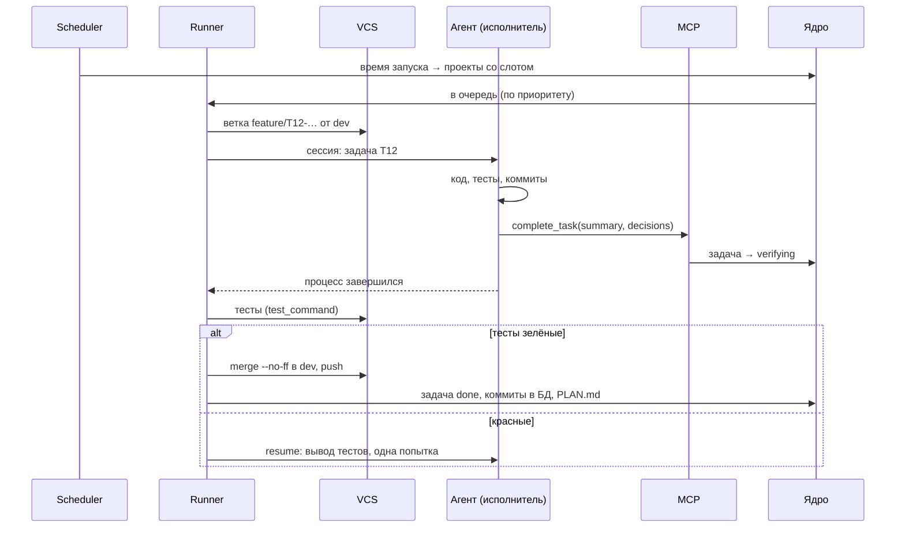

# Архитектура

## Принципы

- **Один процесс.** Бот, планировщик, раннер и MCP-сервер работают в одном asyncio-процессе. Агенты — дочерние процессы (CLI). Так проще деплой, нет межпроцессного взаимодействия, кроме MCP.
- **Ядро не знает про Telegram и агентов.** Бот, MCP-сервер и планировщик — тонкие входные точки, которые вызывают сервисы ядра. Ядро сообщает о событиях через интерфейс `Notifier`.
- **Детерминированное — в коде, творческое — у агента.** Ветки, мержи, тесты-шлюз, календарь, отчёты — код. Реализация задач, архитектура, план — агент.
- **Состояние — в БД.** Файлы в репозиториях (`PLAN.md`) генерируются из БД, а не наоборот.

## Компоненты



| Модуль | Ответственность |
|---|---|
| `dayforge/bot` | Команды, диалоги (FSM aiogram), кнопки, приём ответов и секретов. Реализация `Notifier` — `TelegramNotifier` |
| `dayforge/core` | Сервисы предметной области (см. ниже). Единственный слой, который пишет в БД |
| `dayforge/scheduler` | Задания по времени: ежедневный запуск, бэкап, напоминания, истечение ожидающих действий, сброс чат-сессий |
| `dayforge/runner` | Очередь запусков, выполнение проекта и задачи, шлюз перед мержем, watchdog |
| `dayforge/agents` | `AgentAdapter` и реализации `claude_code`, `codex`; сборка промптов из `prompts/` |
| `dayforge/mcp_server` | MCP-сервер: три набора инструментов (executor, planner, system), авторизация по токену сессии |
| `dayforge/vcs` | git-операции в рабочих директориях; `VcsProvider` (GitHub) |
| `dayforge/db` | Модели SQLAlchemy, миграции Alembic, сессии БД |
| `dayforge/backup` | Снапшот БД и `.env`, вызов restic |

### Сервисы ядра

| Сервис | Что делает |
|---|---|
| `ProjectService` | Создание, статусы, настройки, пауза, архивирование, удаление |
| `PlanService` | Приём и валидация `submit_plan`, версии плана, diff, утверждение, синхронизация задач, генерация `PLAN.md` |
| `TaskService` | Статусы задач, разовые задачи (`add_task`), выбор следующей задачи |
| `CalendarService` | Слоты, указатель дня, прогноз окончания, нехватка дней |
| `RunService` | Постановка в очередь (`scheduled`, `next`, `continue`), история запусков |
| `QuestionService` | Вопросы и секреты агентов, ответы, напоминания |
| `SecretService` | Запись секретов в `.env` проекта |
| `ReportService` | Сборка отчётов из фактов и текста агента |
| `PendingActionService` | Ожидающие подтверждения действия системного агента |
| `SettingsService` | Глобальные настройки (время запуска, агенты по умолчанию, таймауты) |

Правило слоёв: `bot`, `mcp`, `scheduler` → `core` → `db`, `vcs`, `agents`. `runner` вызывается из `core` (постановка в очередь) и сам вызывает `core` (смена статусов). Обратных зависимостей `core` → `bot` нет — только через `Notifier`.

```python
class Notifier(Protocol):
    async def send(self, event: Event) -> None: ...
```

`Event` — типизированное событие (`QuestionAsked`, `TaskPaused`, `DayReport`, `PlanProposed`, `PendingActionCreated`, `DaysShortage`, …). Как его показать — решает бот.

## Ключевые потоки

### Создание проекта



Если пользователь просит правки — текст правок возвращается в ту же сессию планировщика, и он снова вызывает `submit_plan`.

### Задача в ежедневном запуске



Подробно — в [run-lifecycle.md](run-lifecycle.md).

## Конкурентность

- **Линия исполнения** — один воркер раннера. В каждый момент работает не больше одной сессии исполнителя. Запуски проектов идут строго по очереди.
- **Интерактивная линия** — сессии планировщика (создание проекта, перепланирование) и системного агента (`/agent`) запускаются сразу, параллельно линии исполнения: пользователь не должен ждать ночного запуска, чтобы получить план.
- **Блокировка проекта.** Исполнитель и планировщик одного проекта работают в одной рабочей директории, поэтому берут `asyncio.Lock` проекта. Перепланирование проекта, у которого сейчас идёт задача, ждёт её окончания (пользователь видит «перепланирование начнётся после текущей задачи»).
- **Системный агент** работает в режиме только чтения файлов, поэтому блокировки проектов не берёт. Его изменения идут через сервисы ядра в транзакциях БД.
- **SQLite** — в режиме WAL, одна запись за раз; для нагрузки одного пользователя этого достаточно.

## Восстановление после рестарта

При старте процесс:

1. Находит сессии агентов в статусе `running` → помечает `crashed`; их задачи → `paused` с причиной `interrupted`.
2. Запуски в статусе `running`/`queued` → `cancelled`.
3. Проверяет рабочие директории этих проектов: незакоммиченные изменения коммитит как `wip(<key>): interrupted` в ветку задачи.
4. Отправляет одно уведомление: «Система перезапускалась, прервано: …» с кнопкой «Продолжить сейчас».

Пропущенный во время простоя ежедневный запуск **не** выполняется задним числом: слоты прошедших дат просто прошли, прогноз пересчитывается.

## Конфигурация

Два уровня:

- **`.env`** — то, что нужно до старта и не меняется из бота: токены, пути, порты. См. [operations.md](operations.md#конфигурация).
- **Таблица `settings`** — то, что пользователь меняет через `/settings`: часовой пояс, время запуска, агенты по умолчанию, таймауты.

## Размещение на сервере

```
/srv/dayforge/
├── app/                  # код системы (этот репозиторий)
├── .env                  # конфиг системы (600, владелец dayforge)
├── data/
│   ├── dayforge.sqlite3        # БД
│   ├── logs/sessions/    # потоки событий сессий агентов (*.jsonl)
│   └── backup/           # временные снапшоты перед отправкой в restic
└── projects/<slug>/      # рабочие копии проектов (владелец dayforge-agent)
```
