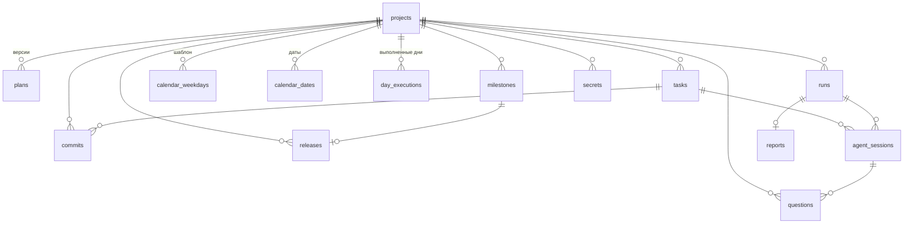

# Модель данных

SQLite (WAL) через SQLAlchemy 2, миграции — Alembic. Все `id` — целые автоинкрементные, если не указано иное. Время хранится в UTC (`created_at`, …), календарные даты — как `DATE` в часовом поясе системы. JSON-поля — `JSON` SQLAlchemy.

## Схема

## Таблицы

### `projects`

| Поле | Тип | Описание |
|---|---|---|
| `slug` | str, unique | Имя репозитория и директории (`todo-bot`) |
| `name` | str | Отображаемое имя |
| `badge` | str | Короткая метка для календаря в боте (эмодзи или буква) |
| `idea` | text | Исходная идея |
| `stack_hint` | text, null | Пожелания по стеку |
| `status` | enum | `draft`, `clarifying`, `planning`, `plan_review`, `active`, `blocked`, `paused`, `completed`, `archived` |
| `priority` | int | Порядок в очереди дня; меньше — раньше. Уникален среди неархивных |
| `planned_days` | int | Число дней в текущем утверждённом плане |
| `current_day` | int | Номер последнего начатого дня плана (0 — ещё не начинали) |
| `planner_agent` | JSON | `{"agent": "claude_code", "model": "…", "effort": "high"}` |
| `executor_agent` | JSON | То же для исполнителя |
| `test_command` | str, null | Команда тестов из плана |
| `day_goals` | JSON | Цели дней из всех утверждённых версий плана (`{"3": "Категории"}`) — для `PLAN.md`: выполненные дни в новые версии плана не входят |
| `repo_path` | str | Рабочая директория |
| `vcs_provider` | str | `github` |
| `remote_url` | str, null | URL удалённого репозитория (после утверждения) |
| `activated_at`, `completed_at`, `created_at` | datetime | |

`blocked` выставляется, когда у проекта есть открытый вопрос, и снимается, когда на все вопросы ответили. `paused` — только по команде пользователя.

### `plans` — версии плана

| Поле | Тип | Описание |
|---|---|---|
| `project_id` | FK | |
| `version` | int | 1, 2, … в пределах проекта |
| `status` | enum | `proposed`, `approved`, `rejected`, `superseded` |
| `content` | JSON | Полный план в формате `submit_plan` ([plan-format.md](plan-format.md)) |
| `summary`, `change_summary` | text | |
| `created_by` | enum | `planner`, `system_agent` |
| `created_at`, `decided_at` | datetime | |

Утверждённой может быть только одна версия. `content` хранит снимок для истории и diff; **живое состояние задач — в `tasks`**.

### `tasks`

| Поле | Тип | Описание |
|---|---|---|
| `project_id` | FK | |
| `key` | str | `T12` (из плана) или `A3` (разовая). Уникален в проекте |
| `origin` | enum | `plan`, `adhoc` |
| `day_number` | int, null | День плана; `null` у разовых |
| `position` | int | Порядок внутри дня |
| `title`, `description` | text | |
| `acceptance_criteria` | JSON | Список строк |
| `depends_on` | JSON | Список ключей |
| `milestone_key` | str, null | |
| `adhoc_when` | enum, null | `now`, `next` (для разовых) |
| `status` | enum | `pending`, `running`, `verifying`, `paused`, `failed`, `done`, `cancelled` |
| `pause_reason` | enum, null | `question`, `secret`, `limit`, `watchdog`, `tests_failed`, `no_result`, `error`, `interrupted` |
| `branch` | str, null | `feature/T12-…` |
| `attempts` | int | Число сессий исполнителя по задаче |
| `summary` | text, null | Из `complete_task` |
| `decisions` | JSON | Из `complete_task` |
| `merge_sha` | str, null | Merge-коммит в `dev` |
| `created_at`, `started_at`, `completed_at` | datetime | |

Статусы и переходы — в [run-lifecycle.md](run-lifecycle.md#статусы-задачи).

### `milestones`

| Поле | Тип | Описание |
|---|---|---|
| `project_id`, `key` | | `M1`, уникален в проекте |
| `title` | str | |
| `version` | str | `v0.1.0` |
| `status` | enum | `pending`, `released` |

Веха выпускается, когда все её задачи (`tasks.milestone_key`) в статусе `done`.

### `calendar_weekdays` — недельный шаблон

| Поле | Тип | Описание |
|---|---|---|
| `project_id` | FK | |
| `weekday` | int | 0 = понедельник … 6 = воскресенье |

Уникальная пара (`project_id`, `weekday`).

### `calendar_dates` — отдельные даты и исключения

| Поле | Тип | Описание |
|---|---|---|
| `project_id` | FK, null | `null` — правило для всех проектов (общий выходной) |
| `date` | date | |
| `kind` | enum | `include` — дополнительный день; `exclude` — исключение из шаблона |

Правила вычисления слотов — в [calendar.md](calendar.md).

### `day_executions` — какие дни плана когда выполнялись

| Поле | Тип | Описание |
|---|---|---|
| `project_id` | FK | |
| `day_number` | int | |
| `date` | date | Когда день начат |
| `trigger` | enum | `scheduled`, `next` |
| `status` | enum | `in_progress`, `done` |

`projects.current_day` = максимальный `day_number` здесь.

### `runs` — запуск одного проекта

| Поле | Тип | Описание |
|---|---|---|
| `project_id` | FK | |
| `batch_id` | str | Группа запусков (один ежедневный запуск, одно нажатие `/next`) — для общего отчёта |
| `mode` | enum | `scheduled`, `next`, `continue` |
| `trigger` | enum | `scheduler`, `bot`, `system_agent`, `auto_resume` |
| `slot_date` | date, null | Дата слота для `scheduled` |
| `status` | enum | `queued`, `running`, `finished`, `blocked`, `limit`, `skipped`, `error`, `cancelled` |
| `day_number` | int, null | Какой день плана начат в этом запуске |
| `error` | text, null | |
| `queued_at`, `started_at`, `finished_at` | datetime | |

### `agent_sessions`

| Поле | Тип | Описание |
|---|---|---|
| `role` | enum | `planner`, `executor`, `system` |
| `project_id`, `task_id`, `run_id` | FK, null | По роли |
| `agent`, `model`, `effort` | str | |
| `cli_session_id` | str, null | Идентификатор сессии CLI — для продолжения |
| `mcp_token_hash` | str | SHA-256 токена MCP |
| `status` | enum | `running`, `ended`, `paused`, `crashed`, `killed` |
| `outcome` | enum, null | `completed`, `failed`, `question`, `secret`, `plan_submitted`, `limit`, `watchdog`, `no_result`, `error` |
| `usage` | JSON | Токены/стоимость, если CLI их сообщает |
| `log_path` | str | `data/logs/sessions/<id>.jsonl` |
| `started_at`, `last_event_at`, `ended_at` | datetime | |

### `questions`

| Поле | Тип | Описание |
|---|---|---|
| `project_id`, `task_id`, `session_id` | FK | `task_id` пуст у вопросов планировщика |
| `kind` | enum | `question`, `secret` |
| `payload` | JSON | Вопросы и варианты ответа или имя и описание секрета |
| `answers` | JSON, null | По одному ответу на вопрос; у секрета значение **не хранится** |
| `status` | enum | `open`, `answered`, `cancelled` |
| `tg_message_ids` | JSON | Сообщения бота — для ответа через reply и редактирования |
| `created_at`, `answered_at`, `last_reminded_at` | datetime | |

### `secrets`

| Поле | Тип | Описание |
|---|---|---|
| `project_id`, `name` | | `STRIPE_KEY`, уникален в проекте |
| `description` | text | |
| `created_at`, `updated_at` | datetime | |

Значение хранится **только** в `.env` проекта.

### `commits`

| Поле | Тип | Описание |
|---|---|---|
| `sha` | str, PK | |
| `project_id`, `task_id` | FK | |
| `branch` | str | |
| `message` | text | |
| `kind` | enum | `agent`, `system` (коммиты плана, merge, init) |
| `committed_at` | datetime | |

Записываются при мерже ветки задачи (все коммиты ветки) и при системных коммитах. Основа для будущего обнаружения ручных изменений.

### `releases`

| Поле | Тип | Описание |
|---|---|---|
| `project_id`, `milestone_id` | FK | `milestone_id` пуст у ручного релиза |
| `tag`, `sha` | str | |
| `created_at` | datetime | |

### `reports`

| Поле | Тип | Описание |
|---|---|---|
| `run_id`, `project_id` | FK | |
| `text` | text | Готовое сообщение |
| `data` | JSON | Факты, из которых собрано (для `/report` и истории) |
| `sent_at` | datetime | |

### `pending_actions`

| Поле | Тип | Описание |
|---|---|---|
| `kind` | str | `approve_plan`, `delete_project`, `archive_project`, `bulk_calendar`, … |
| `payload` | JSON | Аргументы действия |
| `session_id` | FK, null | Кто создал |
| `status` | enum | `pending`, `confirmed`, `rejected`, `expired` |
| `tg_message_id` | int | |
| `expires_at`, `created_at`, `decided_at` | datetime | |

### `settings`

Ключ–значение (`key` str PK, `value` JSON).

| Ключ | По умолчанию | Описание |
|---|---|---|
| `timezone` | `Europe/Moscow` | |
| `run_time` | `03:00` | Время ежедневного запуска |
| `backup_time` | `12:00` | Время бэкапа; если идёт запуск — ждёт его окончания |
| `default_planner_agent` | `{"agent": "claude_code", "model": "opus", "effort": "high"}` | |
| `default_executor_agent` | `{"agent": "claude_code", "model": "opus", "effort": "medium"}` | |
| `system_agent` | `{"agent": "claude_code", "model": "sonnet", "effort": "medium"}` | |
| `watchdog_idle_minutes` | `45` | Сессия без событий дольше — прерывается |
| `test_timeout_minutes` | `30` | Таймаут команды тестов в шлюзе |
| `agent_chat_idle_hours` | `6` | После такой паузы `/agent` начинает новую сессию |
| `limit_auto_resume` | `false` | Продолжать автоматически после сброса лимита подписки |
| `pending_action_ttl_hours` | `24` | |
| `question_reminder_hours` | `24` | Повторное напоминание об открытом вопросе |

Значения моделей — псевдонимы CLI; конкретные модели и уровни reasoning зависят от агента ([agents.md](agents.md)).
