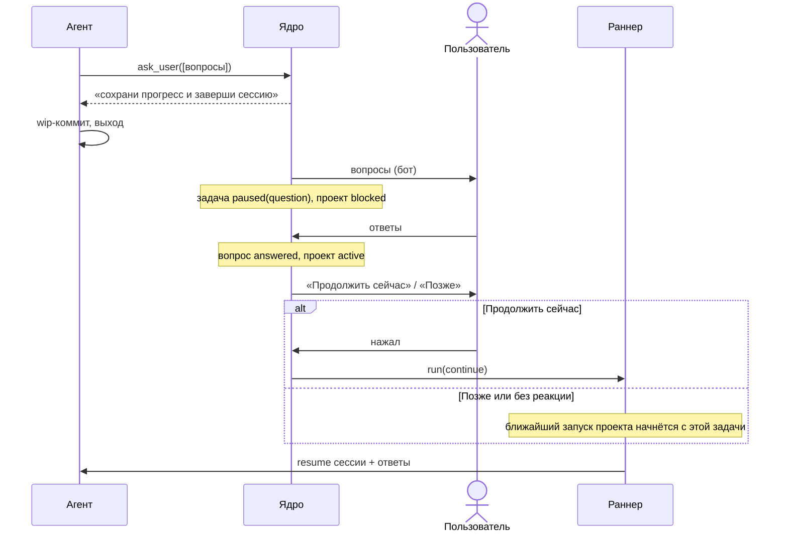
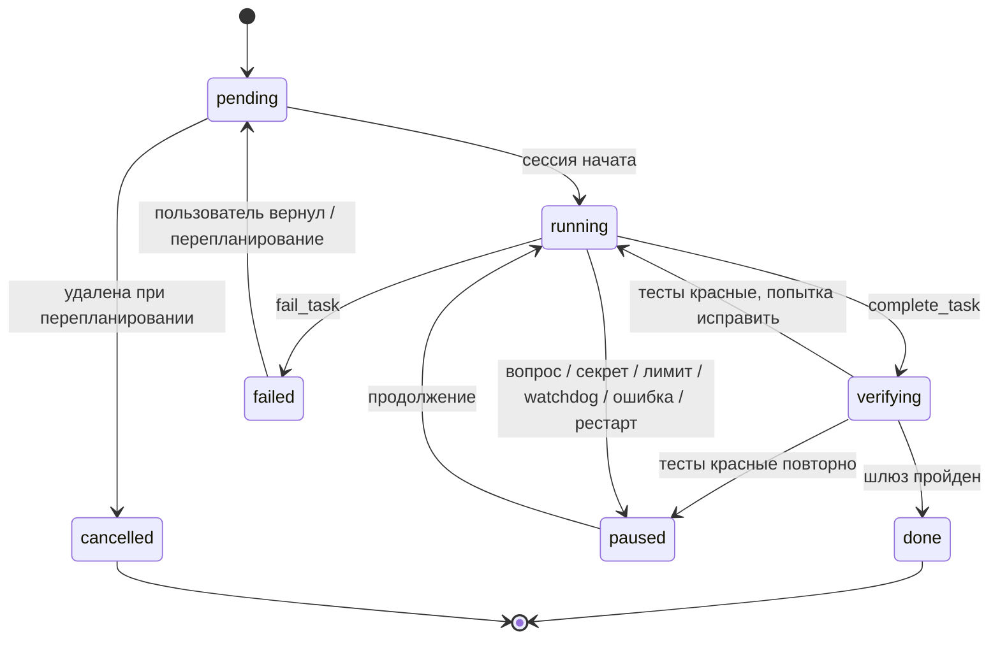

# Жизненный цикл запуска

## Очередь

Раннер — один asyncio-воркер, который берёт элементы из очереди по одному. Элемент очереди — запуск одного проекта (`runs`, статус `queued`).

| Режим (`mode`) | Кто ставит | Что делает |
|---|---|---|
| `scheduled` | Планировщик в `run_time` | Незавершённое + **следующий день плана** |
| `next` | `/next`, `start_run(mode=next)` | То же, что `scheduled`, но вне расписания |
| `continue` | `/run`, «Продолжить сейчас», `add_task(when=now)`, автопродолжение после лимита | Только незавершённое и разовые задачи, **день не начинает** |

Правила очереди:

- Ежедневный запуск ставит проекты со слотом на сегодня ([calendar.md](calendar.md)) в порядке `priority`, все с одним `batch_id`.
- `/next` по нескольким проектам — тоже один `batch_id`, порядок по `priority`.
- Если проект уже стоит в очереди, второй элемент не создаётся: `next` поглощает `continue`; повторный `next` для того же проекта — ставится вторым элементом (пользователь явно хочет два дня).
- Проекты в статусах `paused`, `completed`, `archived` и не утверждённые в очередь не ставятся.

## Запуск проекта

```
run(project, mode):
  если проект blocked:
      scheduled → run.status = skipped, напоминание о вопросе, конец
      next/continue → сообщить «ждёт ответа на вопрос», конец
  взять блокировку проекта
  очередь задач:
      1. разовые задачи (adhoc) в pending
      2. задачи в paused с «продолжаемой» причиной
         (limit, watchdog, tests_failed, no_result, error, interrupted)
      3. если mode ∈ {scheduled, next} и в плане остались дни:
         current_day += 1, day_executions(in_progress),
         задачи этого дня в pending — по position
  для каждой задачи по порядку:
      результат = выполнить_задачу(task)
      done → дальше
      paused(question | secret) → проект blocked, run.status = blocked, стоп
      paused(limit) → run.status = limit, стоп ВСЕЙ очереди
      failed, paused(прочее) → дальше, к следующей задаче*
  если все задачи текущего дня done → day_executions.status = done
  если все задачи плана done → завершить проект
  отчёт по проекту
```

\* Если следующая задача зависит (`depends_on`) от незавершённой, она тоже пропускается в этом запуске (остаётся `pending`).

### Завершение проекта

1. Выпуск последней вехи (`dev` → `main`, тег), если ещё не выпущена.
2. Статус `completed`, будущие слоты проекта вычёркиваются ([calendar.md](calendar.md#вычёркивание)).
3. Итоговый отчёт: сколько дней, задач, версий; ссылка на репозиторий.

### Лимит подписки

Лимит общий для всех проектов, поэтому при `limit` останавливается вся очередь: текущий проект получает `run.status = limit`, остальные элементы очереди — `cancelled`, указатель дня у них не сдвигается (день не начат — слот просто прошёл). Пользователь получает одно уведомление со списком того, что не выполнено.

Если CLI сообщает время сброса лимита и включён `limit_auto_resume`, система ставит `continue` для прерванного проекта и `scheduled`-повтор для отменённых на это время. Иначе — кнопка «Продолжить» в уведомлении.

## Выполнение задачи

```
выполнить_задачу(task):
  ветка: создать feature/<key>-<slug> от dev или переключиться на существующую
  если ветка существует и dev ушёл вперёд: git merge dev в ветку
  сессия:
      первая попытка        → новая сессия, промпт executor_task
      после ответа/секрета  → resume той же сессии, промпт executor_resume с ответом
      после limit/watchdog/
            interrupted/error → resume той же сессии (если CLI её найдёт),
                                иначе новая сессия с заметками из JOURNAL.md
  task.status = running, attempts += 1
  дождаться окончания процесса (watchdog следит за событиями)
  разобрать исход (см. таблицу)
  если исход completed → шлюз
```

### Исход сессии

Исход определяется по **последнему завершающему вызову MCP** в сессии и коду выхода процесса.

| Что произошло | Исход | Статус задачи |
|---|---|---|
| `complete_task` | `completed` | `verifying` → шлюз |
| `ask_user` | `question` | `paused(question)` |
| `request_secret`, секрета нет | `secret` | `paused(secret)` |
| `fail_task` | `failed` | `failed`, уведомление |
| CLI сообщил о лимите | `limit` | `paused(limit)` |
| Watchdog прервал | `watchdog` | `paused(watchdog)`, уведомление |
| Процесс завершился, завершающего вызова не было | `no_result` | одна попытка: resume с напоминанием «вызови complete_task, ask_user или fail_task»; не помогло → `paused(no_result)` |
| Процесс упал (ненулевой код, не лимит) | `error` | `paused(error)`, уведомление с хвостом лога |

После завершающего вызова MCP агенту разрешено только закоммитить WIP и выйти; дальнейшие вызовы MCP отклоняются.

После любой паузы раннер проверяет рабочую директорию: если агент не закоммитил изменения — коммитит сам `wip(<key>): <причина>`. Ветка задачи пушится на GitHub (резервная копия незаконченной работы).

### Шлюз

1. Проверка веток: `dev` и `main` не изменились за время сессии, текущая ветка — ветка задачи. Нарушение → откат ссылок, задача `paused(error)`, уведомление.
2. Незакоммиченные изменения → `wip`-коммит (агент забыл закоммитить — это не ошибка, но фиксируется в отчёте).
3. `git merge dev` в ветку задачи (на случай, если `dev` ушёл вперёд). Конфликт → resume сессии с просьбой разрешить конфликт → снова шлюз.
4. `test_command` с таймаутом `test_timeout_minutes`.
   - Зелёные → шаг 5.
   - Красные, первая неудача → resume сессии: «тесты не прошли, вот последние 200 строк вывода, исправь и вызови complete_task». После окончания — шлюз заново.
   - Красные повторно → `paused(tests_failed)`, задача будет первой в следующем запуске.
5. `git merge --no-ff` в `dev`, коммиты ветки → таблица `commits`, `task.status = done`, `merge_sha`.
6. Перегенерация `PLAN.md`, коммит в `dev`.
7. `push` `dev`, удаление ветки задачи (локально и на GitHub).
8. Если веха задачи полностью выполнена → релиз ([git-workflow.md](git-workflow.md#релизы)).

## Пауза и продолжение



Если к слоту проекта вопрос всё ещё открыт — запуск `skipped`, слот проходит без работы, приходит напоминание (не чаще `question_reminder_hours`), прогноз сдвигается.

## Watchdog

Каждое событие потока CLI обновляет `agent_sessions.last_event_at`. Если событий нет дольше `watchdog_idle_minutes`, раннер завершает группу процессов сессии (SIGTERM, через 30 с — SIGKILL). Ограничения на общую длительность запуска или задачи **нет**: запуск идёт, пока есть активные задачи и не исчерпан лимит.

> Долгая команда агента (сборка, установка зависимостей) не порождает событий, пока не завершится, поэтому таймаут watchdog берётся с запасом.

## Статусы задачи



## Статусы проекта

См. диаграмму в [README](../README.ru.md#жизненный-цикл-проекта). Дополнительно: `archived` — из любого статуса по команде, проект скрыт из списков и календаря, репозиторий остаётся.
